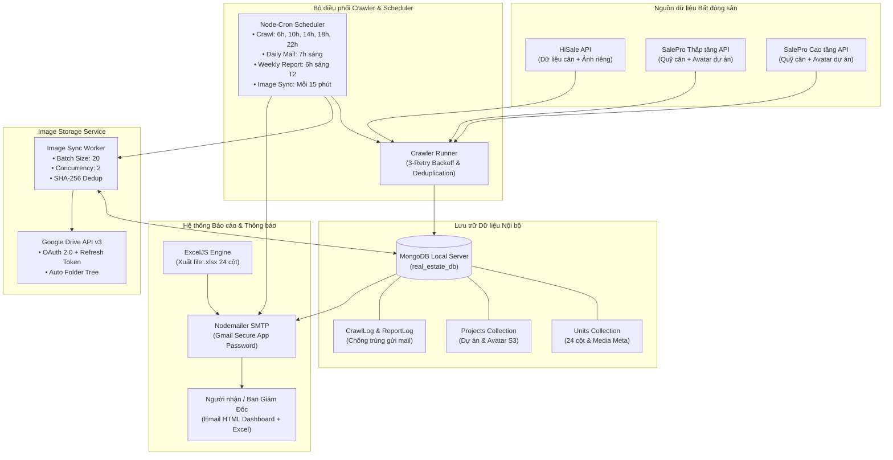

# 🏢 Real Estate Inventory Crawler & Media Storage System (V3)

Hệ thống backend tự động thu thập, chuẩn hóa, đối chiếu dữ liệu rổ hàng bất động sản từ các nền tảng **HiSale** (`hisale.vn`) và **SalePro** (`salepro.com`), lưu trữ nội bộ vào cơ sở dữ liệu **MongoDB Local** trên máy chủ VPS, tự động đồng bộ hình ảnh vào **Google Drive** theo phân cấp thư mục 3 tầng và gửi báo cáo định kỳ (báo cáo ngày & báo cáo tuần) kèm file Excel 26 cột chi tiết qua Gmail SMTP.

---

## 🌟 Tính năng nổi bật trên phiên bản V3 (Chuyên sâu SalePro Media)

- **Nâng cấp chuyên sâu Media SalePro V3**:
  - Tích hợp 3 API công khai chính thức: `get_project_landing`, `get_project_detail`, `get_share_info` (giải mã slug liên kết).
  - Thu thập đầy đủ dữ liệu thực tế từ: `avatar`, `banner_desktop`, `project_image`, `image_data`, `floor_plan`, `product`, `link_general`, `share_content`.
  - Phân loại tài liệu rõ ràng: Bảng giá (`BANG_GIA`), Chính sách bán hàng (`CSBH`), Layout (`LAYOUT`), Hồ sơ pháp lý (`PHAP_LY`), Biểu mẫu cọc (`BIEU_MAU`).
- **Cấu trúc Google Drive 3 tầng chuẩn hóa**:
  - `_Project/`: Lưu toàn bộ ảnh đại diện, banner và phối cảnh dự án.
  - `_FloorPlans/`: Lưu mặt bằng tổng thể, phân khu, tòa nhà và mặt bằng tầng.
  - `_Layouts/<Category>/`: Lưu bản vẽ thiết kế theo từng phân loại chuẩn (`Studio`, `1PN`, `1PN_Plus`, `2PN`, `3PN`, `Lien_ke`, `Biet_thu_song_lap`, `Biet_thu_don_lap`, `Shophouse`, `Penthouse`...).
  - Thư mục mã căn riêng chỉ được tạo khi thực sự có hình ảnh riêng của căn (tránh tạo thư mục rỗng).
- **Thuật toán đối chiếu Layout đa tiêu chí (Multi-attribute Layout Matching)**:
  - Phân tích đa tiêu chí: `project_id`, `subdivision`, `building`, `unit_type`, `area_land`, `area_build`, số phòng ngủ, mã thiết kế.
  - Phân loại 3 mức độ khớp minh bạch:
    - `EXACT`: Khớp chính xác cả loại căn và khoảng diện tích thiết kế.
    - `TYPE_MATCH`: Khớp loại căn, gắn nhãn tham khảo rõ ràng `[Tham khảo: ...]`.
    - `UNMATCHED`: Chưa đủ dữ liệu liên kết layout.
  - Phân biệt tuyệt đối: 1PN với 1PN+, 2PN với 2PN+, Biệt thự đơn lập với Biệt thự song lập.
  - Ghi nhận trung thực: Căn SalePro không có ảnh riêng -> `image_sync_status = 'NO_IMAGE'`, không lấy avatar dự án giả làm ảnh riêng.
- **Tối ưu hiệu năng & Tiết kiệm lưu trữ**:
  - Đồng bộ media cấp dự án 1 lần duy nhất cho toàn bộ các căn cùng dự án (không gọi lặp API).
  - **Chống trùng lặp tuyệt đối bằng SHA-256**: Kiểm tra mã băm nội dung ảnh trước khi upload. Chạy lại nhiều lần 0% upload trùng.
- **Nâng cấp Báo cáo Excel 26 cột chuẩn V3**:
  - Giữ nguyên 18 cột truyền thống và bổ sung 8 cột Google Drive & Media.
  - Tách biệt cột ảnh riêng, ảnh layout thiết kế, mức độ khớp layout, ảnh mặt bằng, ảnh dự án, link thư mục và tài liệu.
  - Tất cả URL cùng loại được đặt trong 1 ô ngăn cách bằng ký tự xuống dòng `\n`.
  - Tích hợp Hyperlink mở trực tiếp thư mục Google Drive.
- **Bộ điều phối linh hoạt (CLI Support)**:
  - Cho phép truyền danh sách `--project-id=1295,1341,1475...` để kiểm thử chính xác từng dự án.

---

## 📐 Sơ đồ kiến trúc hệ thống V2



---

## 📂 Cấu trúc thư mục nguồn

```text
crawler/
├── .env                  # Cấu hình môi trường máy chủ (Tuyệt đối KHÔNG commit)
├── .env.example          # File cấu hình mẫu chuẩn
├── .gitignore            # Loại trừ credentials, token, log, node_modules
├── package.json          # Danh sách thư viện và tập lệnh terminal
├── package-lock.json     # Khóa phiên bản dependencies
├── README.md             # Tài liệu kỹ thuật chi tiết
├── credentials/          # Thư mục chứa khóa xác thực Google Drive (bảo mật)
│   ├── credentials.json  # OAuth 2.0 Client Secret từ Google Cloud
│   └── token.json        # OAuth Access Token & Refresh Token
├── src/
│   ├── index.js          # Điểm khởi chạy chính & Scheduler tự động
│   ├── db.js             # Quản lý kết nối MongoDB Local
│   ├── mailer.js         # Gửi email báo cáo ngày qua SMTP Gmail
│   ├── testMail.js       # Script kiểm thử email báo cáo ngày
│   ├── crawlers/
│   │   ├── hisaleCrawler.js          # Thu thập rổ hàng HiSale
│   │   ├── saleproCrawler.js         # Thu thập SalePro thấp tầng
│   │   └── saleproHighRiseCrawler.js # Thu thập SalePro cao tầng
│   ├── models/
│   │   ├── Unit.js       # Schema căn hộ (Bổ sung 11 trường Media & Drive)
│   │   ├── Project.js    # Schema dự án (Bổ sung Drive Media)
│   │   ├── CrawlLog.js   # Nhật ký phiên quét dữ liệu
│   │   └── ReportLog.js  # Nhật ký gửi báo cáo ngày & tuần (Chống gửi trùng)
│   ├── services/
│   │   ├── hisaleAuth.js           # Phiên đăng nhập HiSale
│   │   ├── saleproAuth.js          # Phiên đăng nhập SalePro
│   │   ├── googleDriveService.js   # Xử lý API v3, tạo thư mục lồng nhau, upload file
│   │   ├── imageStorageService.js  # Tải ảnh, SHA-256, kiểm tra dung lượng, batching
│   │   ├── weeklyReportService.js  # Xử lý số liệu và tạo HTML báo cáo tuần
│   │   ├── reportService.js        # Giao diện HTML email báo cáo ngày
│   │   └── excelService.js         # Xuất buffer Excel 24 cột chuẩn
│   └── scripts/
│       ├── authorizeDrive.js       # Xác thực OAuth 2.0 lần đầu lấy Refresh Token
│       ├── testDrive.js            # Kiểm tra quyền truy cập thư mục tổng & upload thử
│       ├── syncImages.js           # Đồng bộ thủ công một batch hình ảnh
│       └── weeklyReport.js         # Gửi báo cáo tuần thủ công hoặc test giao diện
└── test/
    └── verifyV2.js                 # Bộ kiểm thử tự động toàn diện V2
```

---

## 🗂️ Cấu trúc thư mục trên Google Drive

Toàn bộ hình ảnh và tài liệu được lưu trữ tự động bên trong **Thư mục tổng** (được cấu hình qua biến `GOOGLE_DRIVE_ROOT_FOLDER_NAME` hoặc `GOOGLE_DRIVE_ROOT_FOLDER_ID`, ví dụ: `Real_Estate_Crawler_Test`):

```text
[Google Drive Root Folder] (Tên: GOOGLE_DRIVE_ROOT_FOLDER_NAME / ID: GOOGLE_DRIVE_ROOT_FOLDER_ID)
├── HiSale/
│   ├── Cao_tang/
│   │   └── THE CITYON - IMPERIA OCEAN CITY/
│   │       └── A2.1009/
│   │           ├── image_01.jpg
│   │           └── image_02.jpg
│   └── Thap_tang/
│       └── VINHOMES GLOBAL GATE HA LONG/
│           ├── HG12-08/
│           │   ├── image_01.jpg
│           │   └── image_02.jpg
│           └── HG12-09/
└── SalePro/
    ├── Cao_tang/
    │   └── Ten_du_an/ (VD: CHARMORA CITY_CT, IMPERIA SKY PARK, QTOPIA)
    │       ├── _Project/                     <-- Ảnh đại diện, banner phối cảnh dự án
    │       │   ├── project_avatar.jpg
    │       │   └── banner_01.jpg
    │       ├── _FloorPlans/                  <-- Mặt bằng tổng thể, phân khu, tòa nhà, tầng
    │       │   ├── Mat_bang_tong_the.png
    │       │   └── Mat_bang_tang_dien_hinh.png
    │       └── _Layouts/                     <-- Thiết kế chi tiết theo từng loại căn
    │           ├── Studio/
    │           ├── 1PN/
    │           ├── 1PN_Plus/
    │           ├── 2PN/
    │           └── 3PN/
    └── Thap_tang/
        └── Ten_du_an/ (VD: VINHOMES GREEN PARADISE, VINHOMES HẢI VÂN BAY)
            ├── _Project/
            │   └── project_avatar.jpg
            ├── _FloorPlans/
            │   └── Mat_bang_tong_the.png
            └── _Layouts/
                ├── Lien_ke/
                ├── Biet_thu_song_lap/
                └── Biet_thu_don_lap/
```

**Quy tắc phân loại & Lưu trữ:**
- Phân tầng chính xác theo nguồn: `HiSale` và `SalePro`.
- Phân khúc dữ liệu thực tế: `Thap_tang` và `Cao_tang` (dựa trên loại căn, tầng, tòa, project type).
- Tạo thư mục theo nhu cầu thực tế (*on-demand*): Chỉ khởi tạo khi có dữ liệu thuộc nhóm đó, tuyệt đối không tạo thư mục rỗng.
- Căn SalePro không có ảnh riêng thực tế: Không tạo thư mục rỗng cho từng căn; các căn cùng dự án sẽ liên kết trực tiếp tới URL Drive của ảnh phối cảnh, mặt bằng và layout thiết kế tương ứng.

---

## 🔐 Hướng dẫn cài đặt Google Cloud Console & OAuth 2.0

Để bot tự động tải ảnh lên Google Drive lâu dài trên VPS mà không bao giờ bị hỏi mật khẩu hay hết hạn:

### Bước 1: Bật Google Drive API
1. Truy cập [Google Cloud Console](https://console.cloud.google.com/).
2. Tạo mới một Project (Ví dụ: `Real-Estate-Crawler`).
3. Vào menu **APIs & Services** > **Library**, tìm kiếm `Google Drive API` và bấm **Enable (Bật)**.

### Bước 2: Cấu hình Màn hình đồng ý OAuth (OAuth consent screen)
1. Vào **APIs & Services** > **OAuth consent screen**.
2. Chọn loại **External** (hoặc **Internal** nếu sử dụng Google Workspace doanh nghiệp).
3. Điền tên ứng dụng (VD: `Real Estate Crawler Bot`) và email quản trị viên.
4. Tại mục **Test users**, bấm **Add Users** và thêm địa chỉ Gmail của bạn vào.

### Bước 3: Tạo OAuth Client ID
1. Vào **APIs & Services** > **Credentials** > **Create Credentials** > **OAuth client ID**.
2. Chọn Application type: **Desktop app**.
3. Bấm **Create**, sau đó tải file JSON về máy.
4. Đổi tên file thành `credentials.json` (hoặc `credentials.test.json` khi chạy thử nghiệm) và đặt vào thư mục `credentials/` của dự án.

### Bước 4: Lấy Refresh Token lần đầu (Loopback Flow)
Chạy lệnh xác thực tự động trên terminal:
```bash
npm run drive:auth
```
- Trình duyệt web sẽ tự động mở trang xác thực tài khoản Google qua địa chỉ an toàn `http://127.0.0.1:<PORT>`.
- Đăng nhập tài khoản Google và cho phép ứng dụng truy cập quyền `drive.file`.
- Callback server nhận mã tự động, hệ thống lưu token vĩnh viễn vào `credentials/token.json` (kèm `refresh_token`).
- Token sẽ tự động làm mới ngầm khi hết hạn, không bao giờ cần đăng nhập lại thủ công.

### Bước 5: Khởi tạo thư mục tổng trên Drive
Hệ thống hỗ trợ 2 cách tiếp cận linh hoạt:
1. **Tạo mới tự động bằng API (Khuyên dùng)**:
   ```bash
   npm run drive:create-root
   ```
   Lệnh sẽ tự tạo Thư mục tổng theo tên cấu hình trong `GOOGLE_DRIVE_ROOT_FOLDER_NAME` (mặc định: `Real_Estate_Crawler_Test`), tự động cấp full quyền cho ứng dụng và tự ghi ID mới vào file `.env`. Nếu thư mục đã tồn tại, script sẽ tái sử dụng mà không tạo trùng.

2. **Cấp quyền thư mục công ty có sẵn**:
   Nếu dùng thư mục có sẵn do sếp/công ty tạo từ trước, chạy:
   ```bash
   npm run drive:picker
   ```
   Để chọn và cấp quyền thư mục qua giao diện Google Picker chuẩn.

### Bước 6: Kiểm tra kết nối và phân quyền thư mục
```bash
npm run drive:test
```
Lệnh sẽ kiểm tra quyền truy cập Thư mục tổng, tạo thử thư mục con và upload 1 ảnh kiểm thử để xác nhận hệ thống sẵn sàng 100%.

---

## ⚙️ Cấu hình biến môi trường (.env)

| Biến môi trường | Giá trị mặc định | Giải thích |
|---|---|---|
| `MONGO_URI` | `mongodb://127.0.0.1:27017/real_estate_db` | Đường dẫn kết nối MongoDB Local |
| `CRON_SCHEDULE` | `0 6,10,14,18,22 * * *` | Lịch cào dữ liệu rổ hàng (5 lần/ngày) |
| `MAIL_CRON_SCHEDULE` | `0 7 * * *` | Lịch gửi báo cáo tổng hợp buổi sáng |
| `WEEKLY_REPORT_ENABLED` | `true` | Bật/tắt gửi báo cáo tuần |
| `WEEKLY_REPORT_CRON` | `0 6 * * 1` | Lịch gửi báo cáo tuần (06:00 sáng Thứ Hai) |
| `GOOGLE_DRIVE_ENABLED` | `true` | Bật tính năng đồng bộ hình ảnh Google Drive |
| `GOOGLE_DRIVE_ROOT_FOLDER_NAME` | `Real_Estate_Crawler_Test` | Tên thư mục tổng Google Drive (tự động quản lý) |
| `GOOGLE_DRIVE_ROOT_FOLDER_ID` | *(Folder ID)* | ID thư mục Drive tổng (tự sinh bởi script hoặc chỉ định) |
| `GOOGLE_DRIVE_CREDENTIALS` | `./credentials/credentials.json` | Đường dẫn file OAuth Client credentials |
| `GOOGLE_DRIVE_TOKEN` | `./credentials/token.json` | Đường dẫn file lưu trữ Access & Refresh Token |
| `IMAGE_SYNC_ENABLED` | `true` | Kích hoạt worker đồng bộ ảnh nền |
| `IMAGE_SYNC_CRON` | `*/15 * * * *` | Chu kỳ quét đồng bộ hình ảnh (mỗi 15 phút) |
| `IMAGE_SYNC_BATCH_SIZE` | `20` | Số căn tối đa xử lý trong mỗi đợt đồng bộ |
| `IMAGE_UPLOAD_CONCURRENCY` | `2` | Số luồng upload Drive song song |
| `IMAGE_MAX_SIZE_MB` | `20` | Giới hạn dung lượng tối đa cho mỗi file ảnh |

---

## 📊 Cấu trúc 26 cột trong File Excel Báo cáo (Chuẩn V3)

File Excel đính kèm được tạo tự động trong bộ nhớ với đầy đủ 26 cột:

1. **STT**
2. **Nguồn** (`HISALE` / `SALEPRO`)
3. **Dự án**
4. **Phân khu**
5. **Tòa**
6. **Tầng**
7. **Mã căn**
8. **Loại căn**
9. **Hướng**
10. **DT đất / Thông thủy (m²)**
11. **DT XD / Tim tường (m²)**
12. **Giá bán niêm yết (VNĐ)**
13. **Giá thanh toán sớm (VNĐ)**
14. **Trạng thái**
15. **Tiêu chuẩn bàn giao**
16. **Hỗ trợ ngân hàng**
17. **Link quỹ căn / bảng giá**
18. **Ngày ghi nhận**
19. **Hình ảnh riêng của căn — Google Drive** *(Chỉ có khi căn thực sự có ảnh riêng)*
20. **Hình ảnh layout thiết kế — Google Drive** *(Ghi rõ nhãn [Chính xác: ...] hoặc [Tham khảo: ...])*
21. **Mức độ khớp layout** (`EXACT (Chính xác)`, `TYPE_MATCH (Tham khảo)`, `UNMATCHED (Chưa khớp)`)
22. **Hình ảnh mặt bằng — Google Drive** *(Mặt bằng tổng thể, phân khu, tòa, tầng)*
23. **Hình ảnh phối cảnh dự án — Google Drive** *(Ảnh đại diện và banners tiêu biểu của dự án)*
24. **Thư mục Google Drive** *(Hyperlink click mở trực tiếp thư mục dự án / căn)*
25. **Tài liệu liên quan** *(Bảng giá, CSBH, Pháp lý bóc tách từ landing/share info)*
26. **Trạng thái đồng bộ hình ảnh** (`SUCCESS`, `NO_IMAGE`, `FAILED`, `PENDING`)

---

## 💻 Danh sách tập lệnh Terminal

```bash
# ==========================================
# CRAWLER & SCHEDULER
# ==========================================
npm start                 # Khởi chạy toàn bộ hệ thống tự động (Crawler, Daily, Weekly, Image Sync)
npm run crawl:now         # Quét toàn bộ rổ hàng ngay lập tức và gửi email báo cáo
npm run crawl:init        # Khởi tạo dữ liệu ban đầu (lưu rổ hàng, không gửi mail rác)
npm run crawl:hisale      # Khởi tạo dữ liệu riêng cho sàn HiSale
npm run crawl:salepro     # Khởi tạo dữ liệu riêng cho sàn SalePro
npm run report:now        # Gửi ngay báo cáo tổng hợp ngày kèm file Excel 26 cột

# ==========================================
# GOOGLE DRIVE & MEDIA (V3)
# ==========================================
npm run drive:auth        # Hướng dẫn và xác thực Google Drive OAuth lần đầu
npm run drive:create-root # Tự động tạo thư mục tổng qua API & tự cập nhật ID vào .env
npm run drive:picker      # Cấp quyền thư mục công ty có sẵn qua giao diện Google Picker
npm run drive:test        # Kiểm tra kết nối thư mục tổng và upload thử file
npm run images:stats      # Thống kê trạng thái ảnh từ MongoDB (Chế độ chỉ đọc, không upload)
npm run images:sync -- --source=hisale --limit=5   # Đồng bộ thử nghiệm tối đa 5 căn HiSale
npm run images:sync -- --source=salepro --limit=5  # Xử lý thử nghiệm tối đa 5 căn SalePro

# Đồng bộ Media dự án SalePro V3 (_Project, _FloorPlans, _Layouts và liên kết căn)
npm run images:sync-projects -- --project-id=1295,1341,1475,1355,1385,1277 # Chỉ định ID dự án
npm run images:sync-projects -- --source=salepro --limit=5                   # Theo số lượng

npm run images:backfill -- --source=hisale         # Đồng bộ tồn đọng HiSale theo batch (hỗ trợ resume)
npm run images:backfill -- --source=salepro        # Đồng bộ tồn đọng SalePro theo batch (hỗ trợ resume)

# ==========================================
# BÁO CÁO TUẦN (WEEKLY REPORT) & KIỂM THỬ
# ==========================================
npm run report:weekly     # Tổng hợp và gửi báo cáo tuần ngay lập tức
npm run test:mail:weekly  # Kiểm thử giao diện email báo cáo tuần bằng dữ liệu mẫu
npm run test:mail         # Kiểm thử email báo cáo ngày mẫu
npm test                  # Chạy bộ test tự động toàn diện (node test/verifyV2.js)
```

---

## 🚀 Hướng dẫn triển khai Production trên VPS (Ubuntu / Debian / Windows Server)

Sử dụng **PM2** để quản lý tiến trình chạy nền liên tục 24/7, tự động khởi động lại khi gặp sự cố:

```bash
# 1. Cài đặt PM2 toàn cục
npm install -g pm2

# 2. Khởi chạy bot crawler
pm2 start src/index.js --name "real-estate-crawler"

# 3. Cấu hình tự khởi động cùng hệ điều hành khi VPS reboot
pm2 startup
pm2 save

# 4. Kiểm tra trạng thái và nhật ký hoạt động
pm2 status
pm2 logs real-estate-crawler --lines 100
```

---

## 🛡️ Giới hạn kỹ thuật & Lưu ý vận hành

1. **Hình ảnh riêng của căn SalePro**: API bảng hàng của SalePro hiện chỉ trả về thông số danh sách và link quỹ căn web, chưa có mảng ảnh chi tiết riêng của từng căn. Hệ thống tự động kế thừa ảnh phối cảnh đại diện dự án (`_Project`) và link tài liệu mặt bằng (`_Layouts`), đồng thời giữ trạng thái `NO_IMAGE` đối với ảnh riêng của căn để đảm bảo trung thực dữ liệu, không gọi spam 15.000 request chi tiết gây khóa IP.
2. **Bảo mật thông tin xác thực**: Không bao giờ commit file `.env`, `credentials/credentials.json` hoặc `credentials/token.json` lên Git. Đảm bảo kho lưu trữ GitHub được đặt ở chế độ **Private**.
3. **Quota Google Drive API**: Giới hạn mặc định của Google Drive API v3 là 12.000 requests/phút. Cấu hình `IMAGE_UPLOAD_CONCURRENCY=2` và batch size 20 đảm bảo an toàn tuyệt đối, không bao giờ chạm ngưỡng giới hạn quota.
